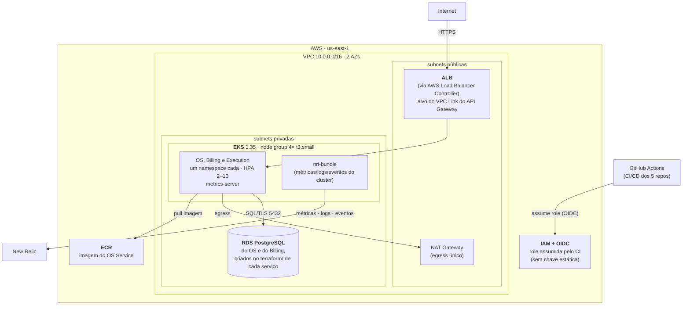

# tc3-infra-k8s

Plataforma do sistema de gestão de oficina mecânica do Tech Challenge FIAP SOAT.

Provisiona, via Terraform, a rede, o cluster EKS e a observabilidade onde rodam os três microsserviços da Fase 4 (OS Service, Billing Service e Execution Service), e traz o workflow que sobe e derruba o ambiente inteiro. Criado na Fase 3, é a **base** dos demais repositórios: `tc3-auth-lambda` e a pasta `terraform/` de cada serviço leem os outputs daqui pelo state remoto.

A visão geral da solução (os cinco repositórios, o diagrama da arquitetura, a divisão dos serviços e a Saga) está no [README do OS Service](https://github.com/fiap-soat-oficina-tech-challenge/tech-challenge-fiap#a-solução-na-fase-4).

| Repositório | Papel |
|---|---|
| [`tech-challenge-fiap`](https://github.com/fiap-soat-oficina-tech-challenge/tech-challenge-fiap) | OS Service e orquestrador da Saga |
| [`oficina-billing-service`](https://github.com/fiap-soat-oficina-tech-challenge/oficina-billing-service) | Billing Service |
| [`oficina-execution-service`](https://github.com/fiap-soat-oficina-tech-challenge/oficina-execution-service) | Execution Service |
| **`tc3-infra-k8s`** (este) | Plataforma: VPC, EKS, observabilidade e o workflow do ambiente |
| [`tc3-auth-lambda`](https://github.com/fiap-soat-oficina-tech-challenge/tc3-auth-lambda) | API Gateway e Lambdas de autenticação e de e-mail |

## O que este repositório cria

| Recurso | Detalhe |
|---|---|
| VPC | 2 AZs, subnets públicas e privadas, NAT único |
| Cluster EKS | Kubernetes 1.35, endpoint público, addons de base |
| Managed node group | 4× `t3.small` (mínimo 3, máximo 4), compartilhado pelos três serviços, um namespace para cada |
| metrics-server | Requisito do HPA da aplicação |
| AWS Load Balancer Controller | Traduz os Ingress dos três serviços em um ALB compartilhado (`group.name: oficina`); alvo do VPC Link do API Gateway |
| ECR | Repositório de imagens do OS Service (Billing e Execution têm o próprio, no `terraform/` de cada um) |
| OIDC do GitHub (`bootstrap/`) | Role `tc3-github-actions`, assumida pelos pipelines dos cinco repositórios sem chave de acesso |
| `nri-bundle` (New Relic) | Métricas, eventos e logs do cluster, sem CloudWatch no caminho |
| Dashboard e alertas | Quatro páginas de painéis e quinze condições (dezesseis com o monitor de Synthetics), como código, entre elas a de mensagem nas DLQs da Saga |
| Monitor de Synthetics | Healthcheck externo, quando a URL pública é informada |

## Tecnologias

Terraform ≥ 1.10 · AWS provider 5.x · módulos `terraform-aws-modules/vpc` e `/eks` · Helm provider · GitHub Actions

## Ordem de execução

```
bootstrap/  →  tc3-infra-k8s  →  tc3-auth-lambda  →  terraform/ dos serviços (OS com o banco do OS, Billing, Execution)
```

Depois do bootstrap, a sequência inteira roda pelo workflow **Ambiente** (seção abaixo). Os passos manuais a seguir ficam como referência.

### 1. Bootstrap (uma vez por conta)

Cria o bucket de state, o budget de proteção de custo e o OIDC do GitHub Actions. Usa state local — por isso mora num diretório separado.

```bash
cd bootstrap
cp terraform.tfvars.example terraform.tfvars   # editar
terraform init
terraform apply
```

Anote os outputs: `state_bucket` e `github_actions_role_arn`.

### 2. Cluster

```bash
cp terraform.tfvars.example terraform.tfvars
terraform init -backend-config="bucket=SEU_BUCKET"
terraform apply

aws eks update-kubeconfig --region us-east-1 --name tc3-oficina-homolog
kubectl get nodes
```

## CI/CD

`.github/workflows/terraform.yml`

- **Pull request** → `fmt`, `validate` e `plan`, com o plano comentado no PR
- **Push em `develop`** → apply automático (rótulo `homolog` no GitHub)
- **Push em `main`** → apply automático (rótulo `production` no GitHub)

> **Ambiente único:** `develop` e `main` aplicam no **mesmo** ambiente na AWS (mesmo state e recursos) — a distinção homologação/produção é apenas o rótulo do deploy no GitHub e foi desconsiderada.

Secrets necessários no repositório:

| Secret | Origem |
|---|---|
| `AWS_ROLE_ARN` | output `github_actions_role_arn` do bootstrap |
| `TF_STATE_BUCKET` | output `state_bucket` do bootstrap |
| `NEW_RELIC_ACCOUNT_ID` | conta New Relic → *Administration* |
| `NEW_RELIC_API_KEY` | conta New Relic → *API keys*, tipo **User** (`NRAK-…`) |
| `NEW_RELIC_LICENSE_KEY` | conta New Relic → *API keys*, tipo **Ingest - License** |

O workflow mapeia cada um para a variável correspondente do Terraform no bloco
`env:` — cadastrar o secret não basta, e nomeá-lo `TF_VAR_NEWRELIC_API_KEY` não
funciona: o Terraform casa `TF_VAR_<nome>` com o nome exato declarado em
`variables.tf`, em minúsculas.

Aplicando da própria máquina, os mesmos valores ficam no `.env` da raiz —
ignorado pelo git (`.env` e `.env.*` no `.gitignore`), já com o mapeamento
`TF_VAR_*`:

```bash
set -a; source .env; set +a
terraform plan
```

O plan valida o formato das credenciais antes de tocar em qualquer recurso:
account ID numérico e license key de 40 caracteres. Placeholder falha ali, com a
explicação, em vez de os agentes subirem e receberem 403 em silêncio.

Duas *variables* do repositório (aba ao lado dos secrets) completam a
configuração, ambas opcionais:

| Variable | Efeito se ficar vazia |
|---|---|
| `ALERT_EMAILS` | política sobe sem canal de notificação — formato JSON: `["fulano@exemplo.com"]` |
| `SYNTHETICS_UPTIME_URL` | monitor externo não é criado; os alertas internos de uptime continuam valendo |

`main` é protegida: merge apenas via Pull Request, com uma aprovação e o check `Plan` verde.

### Subir e derrubar o ambiente inteiro

`.github/workflows/ambiente.yml` aplica, na ordem das dependências, o Terraform deste repositório, do [`tc3-auth-lambda`](https://github.com/fiap-soat-oficina-tech-challenge/tc3-auth-lambda) e a pasta `terraform/` dos três serviços. O código de cada parte continua no repositório dela; o workflow só baixa a `develop` de cada um e roda o Terraform. É disparado por tag, criada no commit atual da `develop`:

```bash
git tag ambiente-subir-1 && git push origin ambiente-subir-1
git tag ambiente-derrubar-1 && git push origin ambiente-derrubar-1
```

| Ação | Ordem |
|---|---|
| Subir | plataforma → Lambdas e API Gateway → `terraform/` do OS (com o banco do OS), do Billing e do Execution |
| Derrubar | namespaces dos serviços (o controller apaga o ALB) → Lambdas → serviços (com os bancos) → plataforma |

O deploy dos serviços fica com o CD de cada repositório. Num ambiente novo, o ALB só existe depois do primeiro deploy, então a subida completa é:

1. tag `ambiente-subir-N`;
2. CD do Execution e do Billing; depois que os dois estiverem verdes, CD do OS (o smoke test do OS usa o Execution);
3. outra tag `ambiente-subir-N`: o Terraform da Lambda acha o ALB pelas tags e cria a rota `ANY /{proxy+}`; o resto sai sem mudanças.

Cada apply espera até 30 minutos pelo lock do state, para não falhar se o apply de um push no mesmo repositório ainda estiver rodando. Usa os mesmos secrets e variables do `terraform.yml`, mais o ARN da layer do New Relic da Lambda, escrito no próprio workflow.

## Custo

O control plane do EKS e os nós são cobrados por hora enquanto existirem. Fora das janelas de trabalho, derrube o ambiente pela tag `ambiente-derrubar-N` (seção acima). O ECR da API tem `force_delete`: o destroy o apaga mesmo com imagens, e o próximo CD do OS gera uma imagem nova.

A subida reconstrói o ambiente inteiro — que é, ela própria, a demonstração de infraestrutura como código funcionando.

O ambiente roda numa **conta AWS própria do grupo**, e não no AWS Academy, então não há limite de sessão nem de serviços: o controle é só de custo, com o budget do `bootstrap/` e o ambiente derrubado fora das janelas de trabalho.

## Arquitetura



Este repositório provisiona a **base** (VPC, EKS, ECR, ALB Controller, OIDC) e a **observabilidade do cluster** (`nri-bundle`, dashboard e alertas). Os **bancos** são criados na pasta `terraform/` de cada serviço e as **Lambdas + API Gateway** em [`tc3-auth-lambda`](https://github.com/fiap-soat-oficina-tech-challenge/tc3-auth-lambda), todos lendo os outputs daqui pelo state remoto.

## Observabilidade

Métricas, logs, traces e alertas no New Relic, com todos os agentes falando
direto com a API — sem CloudWatch Logs, Metric Stream ou Firehose no caminho.
A única exceção é o alerta das DLQs da Saga: o SQS não tem agente, e a métrica
das filas chega pelo Metric Stream da conta.

O desenho completo, o contrato dos campos de log e o que se ganhou e se perdeu
ao sair do CloudWatch estão em [OBSERVABILIDADE.md](OBSERVABILIDADE.md).

Deste repositório saem a chave de ingestão no SSM, o agente de Kubernetes
(`nri-bundle`: CPU, memória e estado de nós, pods e contêineres, eventos do
cluster e logs), o dashboard, as políticas de alerta — incluindo a de consumo
do free tier — e as tags `environment: production` / `project:
tech-challenge-fiap` aplicadas a toda a telemetria. O agente do banco do OS mora no
`terraform/` do OS e a instrumentação da autenticação em `tc3-auth-lambda`, cada
um perto do recurso que monitora.

```bash
terraform output newrelic_dashboard_url
```

## Outputs consumidos por outros repositórios

`vpc_id` · `private_subnet_ids` · `public_subnet_ids` · `cluster_name` · `cluster_endpoint` · `cluster_oidc_provider_arn` · `node_security_group_id`
